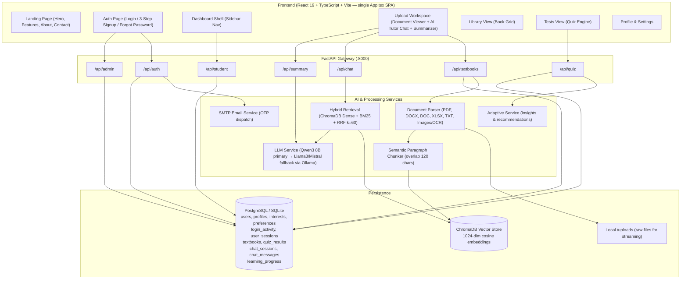

# AARVA — AI-Based Adaptive Learning & Document Intelligence System

[](https://fastapi.tiangolo.com)
[](https://react.dev)
[](https://www.trychroma.com)
[](https://ollama.com)
[](https://www.postgresql.org)

**AARVA** is an AI-driven learning and document intelligence platform that transforms uploaded textbooks, lecture notes, and documents into interactive learning experiences — with an AI tutor, multi-mode summarizer, adaptive quizzes, and a study task planner.

---

## 🌟 Key Features

### 1. Authentication & Account Management
- **Login**: Email and password login for students; JWT token issued on success and stored in `localStorage`.
- **Signup (3 steps)**: Personal info → Interests & preferences → Email OTP verification.
  - Learner types supported: `school`, `college`, `professional`, `independent`.
  - Captures: institution, department, year/semester/grade/job role, subjects, goals, and learning preferences (TTS, STT, font size, etc.).
- **Forgot Password**: Email OTP dispatch via SMTP → 4-digit code entry → new password set; auto-login on success.
- **Session Tracking**: Every login creates a `UserSession` row (JWT `jti`, IP, device, expiry). Logout revokes all active sessions for the user.

### 2. Multi-Format Document Ingestion
- **Supported formats**: PDF (`.pdf`), Word (`.docx`, `.doc`), Excel (`.xlsx`), plain text (`.txt`, `.md`, `.csv`, `.rst`), and images (`.png`, `.jpg`, `.jpeg`, `.bmp`, `.tiff`, `.webp`) via OCR (EasyOCR + pytesseract fallback).
- **Ingestion pipeline**: Parse raw file → Semantic paragraph chunking (120-char overlap) → Embed into ChromaDB → Store metadata & summary in PostgreSQL/SQLite.
- **File serving**: Raw uploaded files streamed back to the browser with the correct `Content-Type` for in-browser preview.
- **Deletion**: Removes the database record, all associated ChromaDB vector chunks, and the local file on disk.

### 3. Document Summarizer (5 Modes)
Pre-computed `summary_data` stored at upload time, or generated on-demand via LLM:
1. **Complete Overview** — high-level summary, key points, topics covered, chapters, definitions, and important notes.
2. **Chapter Breakdown** — per-chapter summary with key points and definitions.
3. **Core Concepts** — concept-focused AI generation.
4. **Page/Section** — page-level AI generation.
5. **Chat History** — stored conversation messages per textbook session (retrieved separately).

### 4. Hybrid RAG AI Tutor Chat
- **Hybrid Retrieval**: ChromaDB dense vector search (1024-dim cosine) + BM25 sparse lexical search, merged via **Reciprocal Rank Fusion (RRF)** (`k=60`, dense weight 0.65, sparse weight 0.35).
- **AI Engine**: Qwen3 8B (primary via Ollama) with automatic fallback to Llama 3, Mistral, or any available local model.
- **Multi-turn conversation**: Full conversation history passed on every request for context continuity.
- **Chat persistence**: Messages saved into `ChatSession` / `ChatMessage` rows in the database when `user_id` and `textbook_id` are provided.
- **Direct alias**: `POST /api/chat` mirrors `POST /api/summary/chat`.

### 5. Adaptive Quiz Engine
- **AI-generated questions**: Uses Hybrid RAG + LLM to generate questions directly from the uploaded document. Falls back to a curated static question bank when Ollama is unavailable.
- **Difficulty levels**: `easy`, `medium`, `hard`, or `mixed`.
- **Submission & scoring**: Correct count, percentage, XP award (50 XP base + bonus up to 30 XP for ≥ 75%), performance feedback message, and badge unlocks.
- **Badges unlocked on quiz**: `Quiz Ace` (≥ 90%), `Perfect Score` (100%), `Knowledge Seeker` (5+ quizzes completed).
- **Leaderboard**: Top 10 students by XP from `LearningProgress`; falls back to a static mock list if no data exists.

### 6. Student Dashboard
- **Overview cards**: Books uploaded count and points earned (books × 80).
- **Study Task Planner**: Add custom tasks with duration presets (15, 30, 45, 60 min). Tasks are persisted per user via `localStorage`.
- **Library view**: Grid of all uploaded books; open a book to enter the document viewer + AI tutor workspace.
- **Tests view**: Start quizzes against any uploaded book.
- **Profile view**: Displays name, email, and total book count.
- **Settings view**: Toggle learning preferences (TTS, STT, larger text, simplified explanations); saved via `PUT /api/student/preferences/{user_id}`.

### 7. Admin Portal
- **Metrics**: Total registered users and count of active sessions (login activity in the last 4 hours).
- **Student roster**: List all users, searchable by name/email and filterable by learner type.
- **Student detail view**: Full profile data and login activity log (last 10 entries).
- **Account control**: Toggle student account active/inactive status with a single click.
- **Admin access**: Admin accounts are seeded at startup; admin login is not accessible from the student portal.

---

## 🏗️ System Architecture



---

## 🛠️ Tech Stack & Libraries

### 1. Core Tech Stack (Architectural Overview Table)

| Layer / Domain | Technology | Type / Specification | Role in AARVA |
| :--- | :--- | :--- | :--- |
| **Frontend Framework** | **React 19** | SPA (Component Hierarchy & State) | Reactive component tree, hooks, and virtual DOM diffing in `App.tsx` |
| **Language** | **TypeScript 5.7** | Static Typing | Strict typing across interfaces, props, models, and API responses |
| **Styling Engine** | **Tailwind CSS v4** + Vanilla CSS | Modern CSS System | Glassmorphism UI, design tokens, CSS variables, and responsive layout |
| **Build Tool & Bundler** | **Vite 8** | Dev Server & Bundler | Lightning-fast Native ESM dev server and production builder |
| **Backend Framework** | **FastAPI** | Asynchronous Web Framework | High-performance Python 3.10+ REST API with auto-generated OpenAPI docs (`/docs`) |
| **ASGI Server** | **Uvicorn** | Asynchronous Server | High-throughput server running on `uvloop` and `httptools` |
| **Database & ORM** | **PostgreSQL / SQLite** + **SQLAlchemy 2.0** | Relational DB & ORM | Persistent storage for users, sessions, textbooks, quizzes, and chat messages |
| **Vector Store** | **ChromaDB** | Embedded Vector Database | Persistent local vector store (`./chroma_db`) with cosine distance indexing |
| **Retrieval Architecture** | **Hybrid RAG (Dense + BM25 + RRF)** | Retrieval Engine | Reciprocal Rank Fusion (`k=60`) merging ChromaDB vector search + BM25 lexical search |
| **LLM Inference Engine** | **Ollama** | Local AI Host | Local model execution engine (`http://localhost:11434`) with zero API cost |
| **Large Language Models** | **Qwen3 8B**, **Llama 3**, **Mistral** | Generative AI | Multi-turn AI tutor chat, 5-mode summarization, and adaptive quiz generation |
| **Embedding Model** | **BGE-Large** (`bge-large:latest`) | Dense Semantic Embedding | 1024-dimensional dense semantic vectors for ChromaDB indexing |
| **Document Preview** | **Multi-Format In-Browser Preview** | Client Rendering | In-browser rendering of PDF canvas, Word HTML, and Excel interactive tables |
| **OCR & Vision** | **EasyOCR** + **Tesseract OCR** | Optical Character Recognition | Scanned document and image text extraction supporting 80+ languages |
| **Voice / Speech** | **Web Speech API** | Browser Native Voice | SpeechRecognition (STT voice-to-text) and SpeechSynthesis (TTS voice readout) |
| **Auth & Security** | **JWT (HS256)** + **Bcrypt** | Token Auth & Hashing | Stateless Bearer token auth and 12-round salted password hashing |
| **Mail / SMTP** | **Gmail SMTP (TLS:587)** | Email Dispatch | 4-digit verification OTP transmission and password reset flows |

---

### 2. Document Preview Engines & Libraries Table

| Document Type | Preview Library / Package | Version | Rendering Method & User Experience |
| :--- | :--- | :--- | :--- |
| **PDF Documents (`.pdf`)** | **`pdfjs-dist`** | `^6.4.299` | Mozilla PDF.js client engine parses binary streams and renders pages onto HTML5 canvas with page navigation |
| **Word Documents (`.docx`)** | **`mammoth`** | `^1.13.0` | Client-side parser converts Word `.docx` structures directly to sanitized HTML for instant in-browser reading |
| **Excel Spreadsheets (`.xlsx`, `.xls`)** | **`xlsx` (SheetJS)** | `^0.18.5` | In-browser spreadsheet parser converts sheets and workbooks into interactive, scrollable HTML data tables |
| **Markdown & AI Notes (`.md`)** | **`react-markdown`** | `^10.1.0` | Client markdown parser rendering bold key terms, headings, bullet lists, code blocks, and formatted study guides |
| **Plain Text (`.txt`, `.csv`, `.rst`)** | Native Browser Reader | Native | Streaming text decoder rendering plain text files with preserved line breaks and formatting |

---

### 3. Large Language Models (LLM) & AI Intelligence Table

| Model / Service | Identifier / URI | Model Type | Parameters & Config | Role in AARVA |
| :--- | :--- | :--- | :--- | :--- |
| **Qwen3 8B** | `qwen3:8b` (via Ollama) | **Primary LLM** | 8B parameters, `temperature=0.3`, `max_tokens=1024`, `timeout=45s` | Generates 5-mode document summaries, multi-turn RAG AI tutor responses, and adaptive quiz questions |
| **Llama 3** | `llama3:latest` (via Ollama) | **Fallback LLM** | 8B parameters, `temperature=0.3`, `max_tokens=1024` | Automatic secondary model invoked if Qwen3 is not pulled or Ollama returns an error |
| **Mistral** | `mistral:latest` (via Ollama) | **Fallback LLM** | 7B parameters, `temperature=0.3`, `max_tokens=1024` | Tertiary fallback conversational model for fast summarization |
| **BGE-Large** | `bge-large:latest` (via Ollama) | **Embedding Model** | 1024-dimensional dense semantic vector output | Converts semantic text chunks into vector embeddings stored in ChromaDB for cosine search |
| **Ollama Daemon** | `http://localhost:11434` | **Local AI Server** | GPU/CPU local inference server | Manages weights, context windows, and provides REST endpoints (`/api/generate`, `/api/embeddings`) |

---

### 4. Libraries & Dependencies Table (Complete Inventory)

| Library / Package | Version | Layer | Category | What It Does & Key Role in AARVA |
| :--- | :--- | :--- | :--- | :--- |
| **`pdfjs-dist`** | `^6.4.299` | Frontend | **Document Preview** | Parses PDF binary files and renders pages onto HTML5 canvas in the left workspace pane |
| **`mammoth`** | `^1.13.0` | Frontend | **Document Preview** | Converts Microsoft Word `.docx` documents to clean HTML previews |
| **`xlsx`** | `^0.18.5` | Frontend | **Document Preview** | SheetJS library parsing Excel workbooks into interactive data tables |
| **`react-markdown`** | `^10.1.0` | Frontend | **Content Rendering** | Markdown parser rendering AI responses, study takeaways, and concept explanations |
| **`react`** | `^19.0.0` | Frontend | **Core UI** | Component hierarchy, custom hooks, and virtual DOM diffing |
| **`react-dom`** | `^19.0.0` | Frontend | **Core UI** | Client-side DOM mounting and reconciliation |
| **`typescript`** | `^5.7.0` | Frontend | **Language** | Static typing across components, models, and API response schemas |
| **`vite`** | `^8.0.5` | Frontend | **Tooling / Bundler** | Native ESM dev server and production builder |
| **`@vitejs/plugin-react`** | `^6.0.0` | Frontend | **Tooling** | React 19 Fast Refresh and JSX transformation |
| **`tailwindcss`** | `^4.0.0` | Frontend | **Styling** | Utility-first CSS engine powering glassmorphism design and responsive layout |
| **`@tailwindcss/vite`** | `^4.0.0` | Frontend | **Styling** | Direct Tailwind v4 Vite compilation plugin |
| **`oxfmt`** | `^0.2.0` | Frontend | **Code Quality** | Ultra-fast Rust-based code formatter |
| **`fastapi`** | `>=0.110.0` | Backend | **API Framework** | Async REST web router with Pydantic validation and automatic OpenAPI Swagger docs |
| **`uvicorn`** | `>=0.28.0` | Backend | **ASGI Server** | High-throughput server running the FastAPI app on `0.0.0.0:8000` |
| **`pydantic`** | `>=2.6.0` | Backend | **Data Validation** | Schema validation, type enforcement, and settings management |
| **`python-multipart`** | `>=0.0.9` | Backend | **File Upload** | Streaming multipart form parser for multi-megabyte document uploads |
| **`sqlalchemy`** | `>=2.0.28` | Backend | **ORM / Database** | Declarative SQL models for users, sessions, textbooks, quizzes, and chat history |
| **`psycopg2-binary`** | `>=2.9.9` | Backend | **Database Driver** | C-optimized PostgreSQL database driver |
| **`pg8000`** | `>=1.31.0` | Backend | **Database Driver** | Pure-Python PostgreSQL driver fallback |
| **`chromadb`** | `>=0.4.24` | Backend | **Vector Database** | Embedded vector database (`./chroma_db`) storing 1024-dim dense embeddings |
| **`rank-bm25`** | `>=0.2.2` | Backend | **Lexical Search** | BM25 Okapi lexical sparse ranking for hybrid keyword retrieval |
| **`requests`** | `>=2.31.0` | Backend | **LLM Integration** | HTTP client sending queries and embeddings requests to Ollama |
| **`python-jose[crypto]`** | `>=3.3.0` | Backend | **Auth & Security** | JWT generation, HS256 signing, and Bearer token verification |
| **`passlib[bcrypt]`** | `>=1.7.4` | Backend | **Auth & Security** | 12-round salted bcrypt password hashing |
| **`PyMuPDF` (`fitz`)** | `>=1.24.0` | Backend | **Document Parsing** | Fast C-backed PDF text and page extraction |
| **`pdfplumber`** | `>=0.11.0` | Backend | **Document Parsing** | Layout-aware fallback for multi-column pages and structured tables |
| **`python-docx`** | `>=1.1.0` | Backend | **Document Parsing** | Extracts paragraphs, headings, bullet lists, and tables from `.docx` files |
| **`mammoth`** | `>=1.6.0` | Backend | **Document Parsing** | Word `.doc`/`.docx` text extraction fallback |
| **`openpyxl`** | `>=3.1.2` | Backend | **Document Parsing** | Excel `.xlsx`/`.xls` workbook and sheet tabular cell parser |
| **`chardet`** | `>=5.2.0` | Backend | **Document Parsing** | Universal character encoding detector for plain text files |
| **`Pillow`** | `>=10.3.0` | Backend | **Vision / OCR** | Image loading, resizing, grayscale conversion, and contrast enhancement |
| **`pytesseract`** | `>=0.3.10` | Backend | **Vision / OCR** | Tesseract OCR wrapper for text extraction from images |
| **`easyocr`** | `>=1.7.1` | Backend | **Vision / OCR** | Standalone deep learning OCR supporting 80+ languages |


---

## 📁 Repository Structure

```
d:\Aarva\
├── frontend/                          # React 19 / TypeScript / Vite SPA
│   ├── public/                        # Static assets (logo, icons)
│   ├── src/
│   │   ├── App.tsx                    # Entire frontend — all pages and components
│   │   ├── index.css                  # Modern styles (glassmorphism, themes, layout)
│   │   └── main.tsx                   # React entry point
│   ├── package.json
│   └── vite.config.ts
├── backend/                           # FastAPI Python Application
│   ├── app.py                         # ASGI app, CORS middleware, startup seeder, /api/chat alias
│   ├── config.py                      # Settings loaded from .env
│   ├── models/models.py               # SQLAlchemy ORM models
│   ├── database/
│   │   ├── postgres.py                # DB engine, session factory, demo seed data
│   │   └── chroma.py                  # ChromaDB collection management & retrieval
│   ├── routes/
│   │   ├── auth.py                    # Signup, login, OTP send/verify, reset-password, sessions
│   │   ├── admin.py                   # Metrics, student roster, student detail, status toggle
│   │   ├── students.py                # Dashboard, XP award, preferences update
│   │   ├── textbooks.py               # Upload, file serve, delete
│   │   ├── summary.py                 # Summary modes, chat history, RAG chat
│   │   └── quiz.py                    # Generate questions, submit answers, leaderboard
│   ├── services/
│   │   ├── llama_service.py           # Ollama inference — RAG chat & summarization
│   │   ├── hybrid_retrieval.py        # RRF fusion of ChromaDB dense + BM25 sparse
│   │   ├── knowledge_base_service.py  # End-to-end ingestion pipeline coordinator
│   │   ├── document_parser.py         # Multi-format text extraction (PDF, DOCX, XLSX, TXT, OCR)
│   │   ├── chunking_service.py        # Semantic paragraph chunker
│   │   ├── quiz_service.py            # AI question generation + static fallback bank
│   │   ├── adaptive_service.py        # Quiz insight and recommendations logic
│   │   ├── auth_service.py            # JWT creation and bcrypt password hashing
│   │   └── email_service.py           # SMTP OTP dispatch and verification
│   └── requirements.txt
└── docs/
    ├── ARCHITECTURE.md                # System architecture, workflows & tech stack detailed notes
    ├── DB_SCHEMA.md                   # Database schema and ER diagram
    └── API_OVERVIEW.md                # REST API endpoint reference
```

---

## ⚙️ Setup & Configuration

### 1. Prerequisites
- **Node.js** v18+ and `npm`
- **Python** 3.10+
- **Ollama** for local LLM inference — run `ollama pull qwen3:8b` (or `ollama pull llama3`)

### 2. Backend Setup
```bash
cd backend

# Create and activate virtual environment
python -m venv venv
# Windows:
venv\Scripts\activate
# Linux/macOS:
# source venv/bin/activate

# Install dependencies
pip install -r requirements.txt
```

> Configure your `.env` file in `backend/` by referencing `backend/.env.example` for all configurable keys (database connection, JWT secret, Ollama base URL, SMTP mail configuration, ChromaDB storage path, etc.).

### 3. Frontend Setup
```bash
cd ../frontend
npm install
```

---

## 🚀 Running Locally

### 1. Start the FastAPI Backend
```bash
cd backend
python -m uvicorn app:app --port 8000 --reload
```
- **API**: `http://127.0.0.1:8000`
- **Swagger Docs**: `http://127.0.0.1:8000/docs`
- **Health Check**: `http://127.0.0.1:8000/api/health`

### 2. Start the React Frontend
```bash
cd frontend
npm run dev
```
Open `http://localhost:5173` in your browser.

---

## 🔑 Demo Accounts

Pre-seeded at startup via `database/postgres.py`:

| Role | Email | Password | Details |
|---|---|---|---|
| **Sample Student** | `student@college.edu` | `student123` | Alex Morgan — IIT Madras (CSE) |
| **Administrator** | `admin@aarva.edu` | `admin123` | Platform Admin Portal |

---

## 🐳 Running with Docker (Recommended for Deployment)

Launch the entire stack (React frontend, FastAPI backend, and PostgreSQL database) with a single command:

```bash
# 1. Copy Docker environment file
cp .env.example .env

# 2. Build and launch all services in detached mode
docker compose up --build -d
```

- **Frontend Application**: `http://localhost` (or `http://localhost:5173`)
- **FastAPI Backend & Docs**: `http://localhost:8000/docs`
- **PostgreSQL Database**: `localhost:5432`

See the full [Docker Deployment Guide](file:///d:/Aarva/docs/DEPLOYMENT.md) for production options, persistent storage, and GPU/Ollama setup.

---

## 📚 Documentation Reference

- 🐳 [Docker Deployment & Production Guide](file:///d:/Aarva/docs/DEPLOYMENT.md)
- 📘 [Architecture Overview & Workflow Diagrams](file:///d:/Aarva/docs/ARCHITECTURE.md)
- 🗄️ [Database Schema & ER Diagram](file:///d:/Aarva/docs/DB_SCHEMA.md)
- 🔌 [API Endpoints Reference](file:///d:/Aarva/docs/API_OVERVIEW.md)

---

## 🎥 Project Demo Video

- **Watch the Video Walkthrough on Google Drive**: [AARVA System Demo Video](https://drive.google.com/file/d/1ybVgyU1iQzW7RVQTdciTqkYm3qatSfJi/view?usp=sharing)
