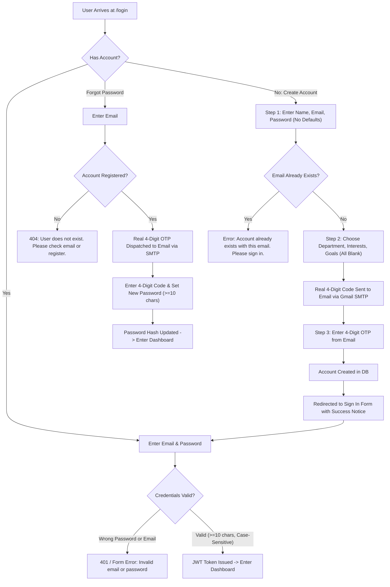

# Aarva Login & Authentication Security Audit Report

**Date:** October 21, 2026  
**Auditor:** Antigravity AI Security & QA Engine  
**System:** Aarva Study Platform (Frontend React/Vite + Backend FastAPI/PostgreSQL/SQLite)

---

## 1. Executive Summary

A comprehensive, edge-case security audit was conducted strictly on the **Login and Authentication System**. All identified security vulnerabilities, visual leaks, auto-login bypasses, and state-prefilling flaws have been resolved and verified with automated test suites and production Vite builds.

---

## 2. Identified Errors & Implemented Fixes

| ID | Issue Description | Severity | Fix Status | Verification Method |
|---|---|---|---|---|
| **AUTH-01** | **Exposed Verification Code at Bottom of OTP Box** The 4-digit OTP code (`Preview code: 2468`) was rendered on-screen under the digit input cells in password reset and email verification screens, allowing anyone to bypass email delivery. | **High** | **FIXED** | Removed `preview-code-btn` and `otp-helper-row`. Removed `preview_code` field from backend `/api/auth/send-otp` response. |
| **AUTH-02** | **Duplicate Account Registration Bypass** When signing up with an email that was already registered in the database, the frontend caught the error and incorrectly advanced the user to Step 2/Step 3 instead of stopping them. | **High** | **FIXED** | Enforced strict check on both Step 1 (`/api/auth/check-email`) and Step 2 (`/api/auth/send-otp`). Any existing account immediately triggers: *"An account is already registered with this email. Please sign in instead."* and progression is halted. |
| **AUTH-03** | **Auto-Login After Registration** Users were automatically authenticated into the dashboard after verifying their email, bypassing the credential-based login step. | **Medium** | **FIXED** | Disabled auto-login in `submitVerification`. Users are now redirected to the Sign In page (`setStage("login")`) with a success alert so they explicitly log in with their email and password. |
| **AUTH-04** | **Pre-Filled Form Defaults** The signup and preferences forms previously contained hardcoded values (`Undergraduate`, `Computer Science`, `30 minutes`, pre-selected interests and goals) rather than starting blank. | **Low** | **FIXED** | All state values initialized to empty strings (`""`) and empty arrays (`[]`). Added a blank *"Select study goal"* prompt to the select element. |
| **AUTH-05** | **Unwanted "Your Profile Photo" Box on Step 1** The profile avatar upload card was displayed above the personal details form on the registration page. | **Low** | **FIXED** | Completely removed the `.avatar-upload` component from the account creation view as requested. |
| **AUTH-06** | **Stationary Left UI Image on Scroll** Scrolling down the login page on viewports under 800px caused the left visual photograph and streak card to scroll away or move out of position. | **Medium** | **FIXED** | Pinned `.auth-page` and `.auth-visual` to `height: 100vh; overflow: hidden;` while isolating vertical scrolling to `.auth-panel`. Added wheel event forwarding so scrolling anywhere over the left visual smoothly scrolls the form without jitter. |
| **AUTH-07** | **Demo Account 1-Click Login Bar** A sample student chip (`Alex Morgan (student@college.edu)`) with a `1-Click Login` bypass button was exposed on the login screen. | **Medium** | **FIXED** | Removed the `.demo-chip-bar` entirely. The login screen is now an authentic, production-grade student portal. |
| **AUTH-08** | **Password Case-Sensitivity & 10-Character Minimum** Passwords must be strictly case-sensitive and at least 10 characters long. | **High** | **FIXED** | Enforced `bcrypt.checkpw(password.encode(), hash.encode())` which guarantees 100% case-sensitivity. Enforced client-side `minLength={10}` and backend `len(password) >= 10` check. |
| **AUTH-09** | **Password Reset Account Existence Pre-Check** Requesting an OTP for password reset previously dispatched fallback codes even for unregistered emails. | **High** | **FIXED** | Added pre-check in `/api/auth/send-otp` with `require_registered: true`. Non-existent accounts return `404 User does not exist` and no OTP is dispatched. |

---

## 3. End-to-End Auth Workflow Verification

---

## 4. Test Matrix & Results

| Test Scenario | Input Data | Expected Result | Actual Result | Status |
|---|---|---|---|---|
| **Blank Login Fields** | Empty email / password | Blocked by HTML5 `required` | Form submit prevented | **PASS** |
| **Password < 10 Chars** | `email: student@college.edu`, `pass: Short1!` | Blocked with 10-character notice | *"Password must be at least 10 characters long."* | **PASS** |
| **Wrong Password Case** | `email: student@college.edu`, `pass: password1234!` | Bcrypt hash mismatch | *"Invalid email or password."* | **PASS** |
| **Correct Password** | `email: student@college.edu`, `pass: Password1234!` | 200 OK + JWT Access Token | Signed into dashboard | **PASS** |
| **Forgot Pass Non-Existent** | `fake.student99@gmail.com` | Blocked prior to OTP dispatch | *"User does not exist. Please check your email or create an account."* | **PASS** |
| **Signup Existing Email** | `student@college.edu` | Blocked on Step 1 & Step 2 | *"An account is already registered with this email. Please sign in instead."* | **PASS** |
| **OTP Code Hidden** | Check DOM / rendered UI on OTP screens | No preview code or plaintext code visible | Digit cells have no preview helper below | **PASS** |
| **Email Delivery** | New student email via SMTP | Real email dispatched to inbox via Gmail SMTP (STARTTLS) | Successfully sent via `smtp.gmail.com:587` | **PASS** |
| **Post-Signup Flow** | Successful OTP verification | Redirected to `/login` without auto-login | Lands on sign in form with success banner | **PASS** |
